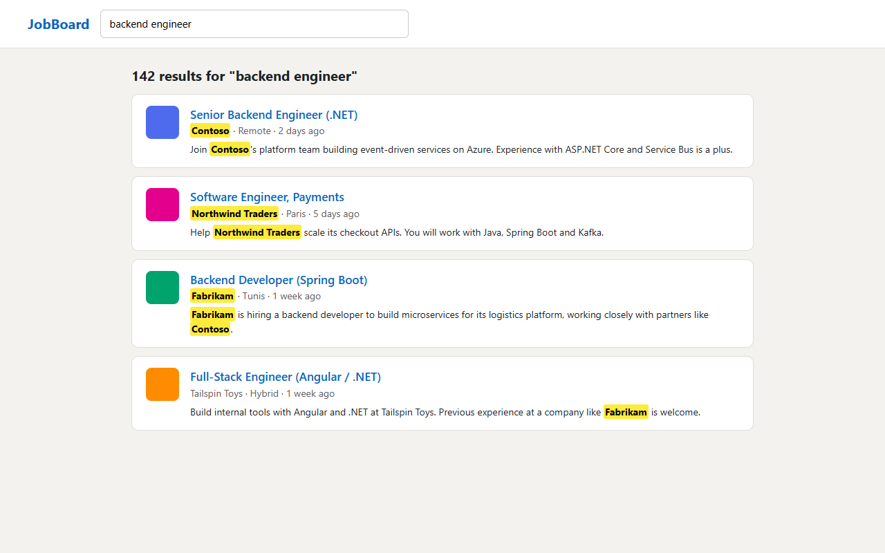
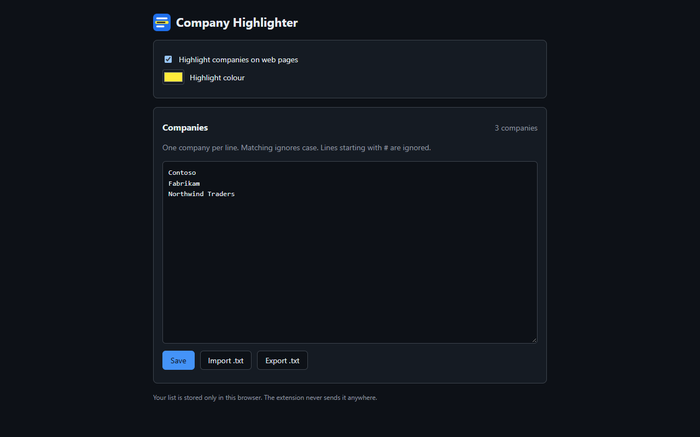
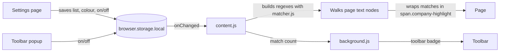

# Company Highlighter

[](https://github.com/Ahmed-Manai/company-highlighter-browser-extension/actions/workflows/ci.yml)


A lightweight browser extension that highlights the companies from **your own list** on any web page.

Useful when scanning job boards, LinkedIn feeds, news or search results for the companies you care about: target employers, clients, competitors, or companies you want to avoid.



<details>
<summary>Settings page</summary>



</details>

**[Download the latest release](https://github.com/Ahmed-Manai/company-highlighter-browser-extension/releases/latest)** · If it saves you time, a ⭐ helps others find it.

## Features

- **Your list, in the browser:** paste names, or import and export a `.txt` file, from the settings page. No files to edit.
- **Toolbar popup and badge:** turn highlighting on or off, and see how many matches the current page has.
- **Your colour:** pick any highlight colour.
- **Smart matching:** case-insensitive and whole-name only (`Acme` does not match `Acmeish`). Names with symbols such as `AT&T` or `C++` work, and the longest name wins when entries overlap (`Acme Labs` over `Acme`).
- **Dynamic pages:** keeps up with infinite scroll and single-page apps.
- **Large lists:** names are compiled into a few regular expressions (500 names each) instead of being checked one by one.
- **Safe:** never touches scripts, styles, form fields or editable areas, and inserts highlights as plain DOM nodes, so page text can never inject markup.
- **Private:** no network requests, no tracking. Your list stays in your browser.

## Installation

### From source (Chrome, Edge, Brave)

1. Download or clone this repository.
2. Open `chrome://extensions` (Edge: `edge://extensions`) and turn on **Developer mode**.
3. Click **Load unpacked** and select the repository folder.

### From source (Firefox 121+)

1. Open `about:debugging#/runtime/this-firefox`.
2. Click **Load Temporary Add-on...** and select `manifest.json`.

Temporary add-ons are removed when Firefox restarts.

A ready-to-install zip is attached to each [release](https://github.com/Ahmed-Manai/company-highlighter-browser-extension/releases).

## Usage

1. After installing, the settings page opens. Add one company per line and click **Save**, or click **Import .txt** to load a list ([`companies.example.txt`](companies.example.txt) is a sample).
2. Browse as usual: matches are highlighted and counted on the toolbar badge.
3. Click the toolbar icon to switch highlighting off or on, or to open the settings again.

Changes apply to open tabs immediately; no reload needed.

### List format

- One company per line; matching ignores case and keeps the page's original casing.
- Blank lines, surrounding spaces and duplicates are ignored.
- Lines starting with `#` are comments.

## How it works



| File | Purpose |
|------|---------|
| `manifest.json` | Manifest V3 definition, shared by Chrome and Firefox |
| `matcher.js` | Pure matching logic: list parsing, regex building, overlap resolution |
| `settings.js` | Default settings and storage helpers |
| `content.js` | Highlights matches on the page and follows list or page changes |
| `background.js` | Toolbar badge; imports a pre-1.0 `companies.txt` once |
| `options.html` / `options.js` | Settings page |
| `popup.html` / `popup.js` | Toolbar popup |
| `styles.css`, `ui.css` | Highlight style; settings and popup style (light and dark) |
| `icons/` | Icons, generated by `scripts/generate_icons.py` |

## Permissions

| Permission | Why it is needed |
|------------|------------------|
| `storage` | Saves your company list and settings in the browser. |
| Content script on all sites (`<all_urls>`) | The highlighter has to read the text of the pages you visit to find company names. It only reads text and wraps matches in `<span>` elements. |

The extension makes no network requests and sends no data anywhere. See [PRIVACY.md](PRIVACY.md).

## Development

```bash
npm install   # installs jsdom for the tests
npm test      # runs the matcher and content script tests
```

The extension itself has no build step and no runtime dependencies. After a change, click reload on the extensions page and refresh the test tab. To regenerate the icons, run `python scripts/generate_icons.py`.

Pushing a tag such as `v1.0.0` runs the release workflow, which tests the extension and attaches the store-ready zip to a GitHub release.

## Troubleshooting

- **Nothing is highlighted:** check that highlighting is on in the popup and that your list is saved in the settings page.
- **"Not available on this page":** browser pages (`chrome://`, `about:`, the extension stores, the PDF viewer) cannot be scripted by extensions.

## Contributing

Bug reports and pull requests are welcome; see [CONTRIBUTING.md](CONTRIBUTING.md). Release notes are in [CHANGELOG.md](CHANGELOG.md).

## License

[MIT](LICENSE)
